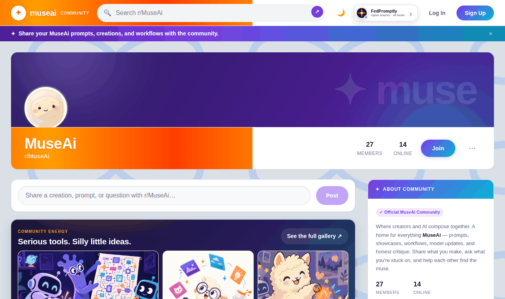
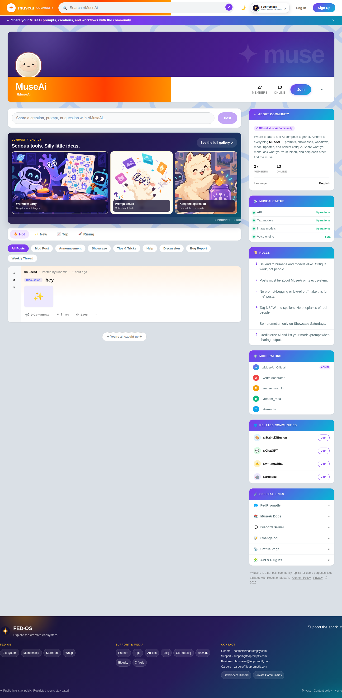
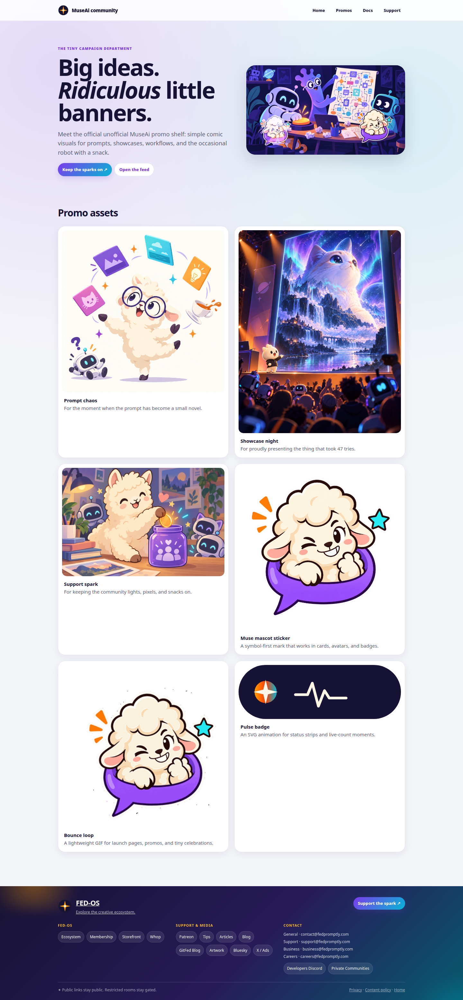
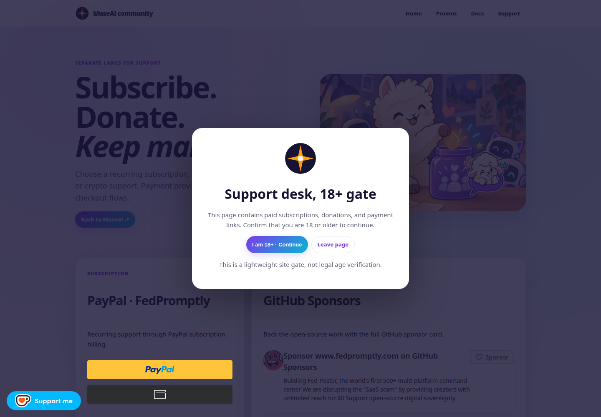
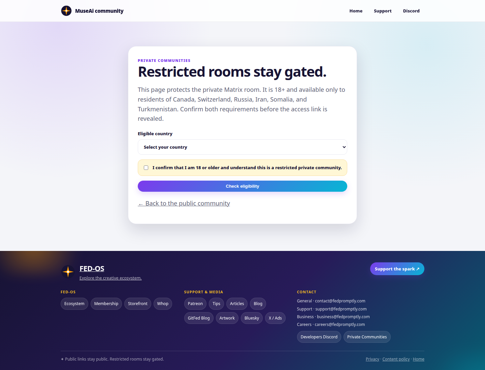

# MuseAi Live Counts Bundle

A playful, static HTML community site for sharing MuseAi prompts, creations, workflows, model updates, and helpful feedback.

> **Project status:** Working static bundle. The repository has no published live demo, package manager, build step, or automated test suite. It is ready to preview locally and deploy as static files.

## Why this exists

AI community pages often become a pile of disconnected links, placeholder buttons, and one-off embeds. Visitors cannot tell what is live, where to start, or which links are public versus paid or restricted.

MuseAi Live Counts makes that first visit clearer. It combines a Reddit-style community feed, real Supabase-backed interactions, a symbol-first visual identity, animated promotional surfaces, and explicit HTML destinations for the surrounding ecosystem.

The project is intentionally small: no framework, no bundler, and no installation step. It can be dropped into GitHub Pages, Cloudflare Pages, or a Cloudflare Worker that serves static files.

## See it work

There is no hosted demo URL configured in this repository yet. The quickest real demo is the local homepage:

```bash
cd MuseAi-Live-Counts-Bundle
python3 -m http.server 8080
```

Open [http://localhost:8080/index.html](http://localhost:8080/index.html). The same `index.html` is the production entry point.

### Real application walkthrough

This GIF is captured from the actual rendered homepage while scrolling through the live static app. It is not a mockup.



Useful pages to open immediately:

- [Community feed](index.html) — the main homepage and Supabase-connected feed.
- [Promotional gallery](promotions.html) — comic artwork, mascot assets, GIF, and animated SVG showcase.
- [Support hub](support.html) — age-gated subscription, donation, sponsorship, crypto, and card support lanes.
- [Discord servers](discord.html) — server selector with a confirmation-gated NSFW access request flow.
- [Private communities](private-communities.html) — 18+ and country-eligibility gate before the Matrix link is revealed.

## Screenshots

These screenshots were captured from the local application with Chromium.

### Community homepage



### Promotion gallery



### Support age gate



### Private community gate



## Quick start

There is nothing to install for the static frontend.

```bash
# enter the bundle
cd MuseAi-Live-Counts-Bundle

# run a local static server
python3 -m http.server 8080

# open the application
# http://localhost:8080/index.html
```

For live community behavior, run [`supabase-setup.sql`](supabase-setup.sql) in the configured Supabase SQL editor first. The SQL expects an existing `public.profiles` table. Without Supabase setup, the visual pages still render, but live posts, profiles, votes, comments, presence, and counts will not be available.

There is currently no automated test command. The bundle is plain HTML/CSS/JS and can be checked with a static server plus browser inspection.

## What is included

- Reddit-inspired community feed with Hot, New, Top, Rising, and flair filters.
- Supabase email authentication and member profiles.
- Durable community posts, comments, voting, presence, and live counts.
- Symbol-based SVG favicon and reusable MuseAi identity marks.
- Animated FedPromptly invite button beside login with a full open-source social-card modal.
- Animated orange flow bars, aurora banner, mascot motion, promo glow, marquee motion, and reduced-motion fallbacks.
- Full static HTML routes instead of `href="#"` placeholders.
- Age-gated support page with PayPal subscription, GitHub Sponsors, Ko-fi, Buy Me a Coffee, NOWPayments, and Stripe surfaces.
- Discord server selector with a separate 18+ access-instructions flow that does not expose the restricted invite URL.
- Animated FED-OS footer with public ecosystem, media, support, and contact shortcuts.
- Gated Private Communities page for the restricted Matrix room.
- Cloudflare `_headers` file and a friendly `404.html` fallback.

## Route map

| Route | Purpose |
| --- | --- |
| [`index.html`](index.html) | Main community feed and live Supabase integration |
| [`promotions.html`](promotions.html) | Visual promotion gallery and asset showcase |
| [`support.html`](support.html) | Age-gated support and payment hub |
| [`discord.html`](discord.html) | Discord server selector and gated NSFW access request |
| [`private-communities.html`](private-communities.html) | Age and country gate for restricted Matrix access |
| [`docs.html`](docs.html) | Community documentation landing page |
| [`api.html`](api.html) | API and plugin landing page |
| [`status.html`](status.html) | Static status page surface |
| [`404.html`](404.html) | Static-hosting fallback page |
| [`supabase-setup.sql`](supabase-setup.sql) | Database schema, RLS policies, and RPC functions |

## Visual asset gallery

The artwork below is included in the repository and is used by the homepage, promotion page, support page, 404 page, and README.

### Comic promotion artwork

| Workflow party | Prompt chaos |
| --- | --- |
|  |  |

| Showcase night | Support spark |
| --- | --- |
|  |  |

### Brand and animation assets


- [Animated bouncing mascot GIF](assets/museai-bounce.gif)
- [Animated pulse SVG](assets/museai-pulse.svg)
- [Symbol mark SVG](assets/museai-symbol.svg)
- [Symbol favicon SVG](assets/favicon.svg)
- [Real application demo GIF](assets/demo/museai-demo.gif)

## Deployment

### GitHub Pages

Publish the complete `MuseAi-Live-Counts-Bundle` folder from the repository root or configure GitHub Pages to serve the folder containing `index.html`. Keep the `assets/` directory beside the HTML files. Relative `.html` routes are used throughout.

No GitHub Pages workflow is included yet, and no live GitHub Pages URL is configured in this repository.

### Cloudflare Pages / Workers

Deploy the same folder as a static site. The included [`_headers`](_headers) file adds basic security headers on Cloudflare Pages. A Cloudflare Worker can also serve the directory without changing the relative routes.

The project does not include a `wrangler.toml`, so deployment configuration still needs to be added in the target Cloudflare project if you want a scripted Worker deployment.

## Supabase setup

Run [`supabase-setup.sql`](supabase-setup.sql) in Supabase before expecting the community database features to work. The frontend uses the configured publishable Supabase client key and calls the included RPC functions for:

- Community presence and counts.
- Anonymous and authenticated activity identity merging.
- Durable votes and viewer vote state.
- Comment creation.
- Public post and comment reads.

Review the existing `public.profiles` schema and production RLS permissions before launch.

## Support and restricted-access notes

`support.html` contains third-party payment surfaces supplied for this project. Review provider account settings, production terms, tax language, refund policy, and eligibility requirements before publishing.

The support age screen and private-community eligibility flow are lightweight client-side gates. They are interface controls, not legal age verification, identity verification, or server-side geographic enforcement.

## Repository limitations

- No package manager or build pipeline is required.
- No automated test suite is included.
- No live demo URL is currently configured.
- The feed needs the included Supabase SQL setup and a compatible existing profiles table for live database behavior.
- External payment, Discord, social, and media links depend on third-party availability.

## License

No license file is currently included. Add a license before accepting external contributions or redistributing the project.