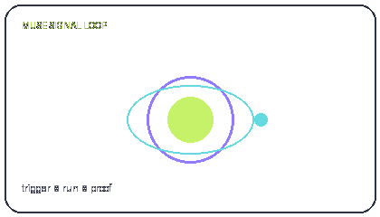
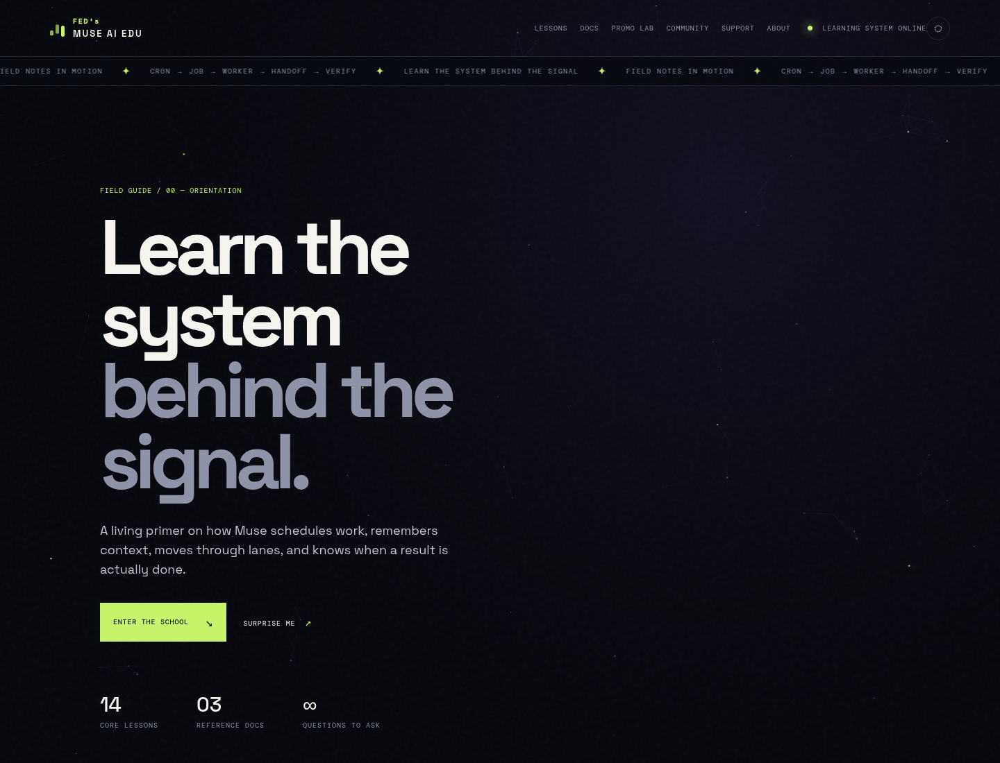
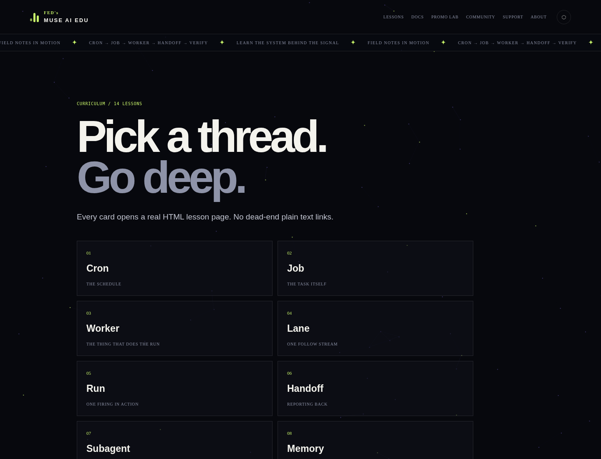
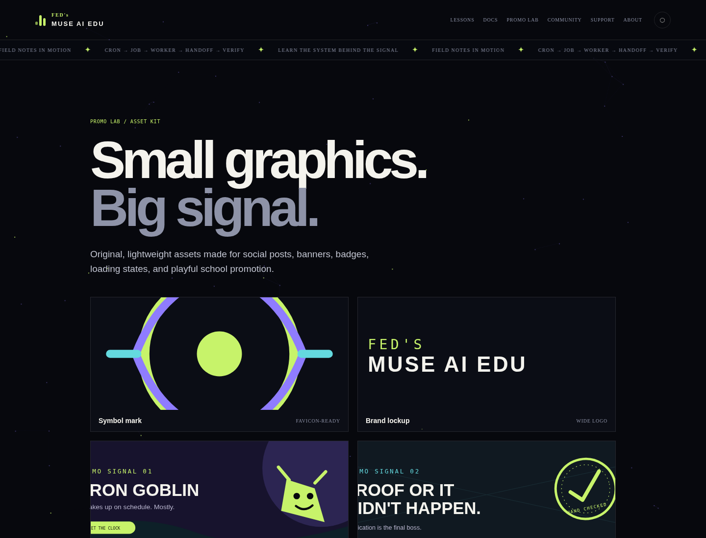
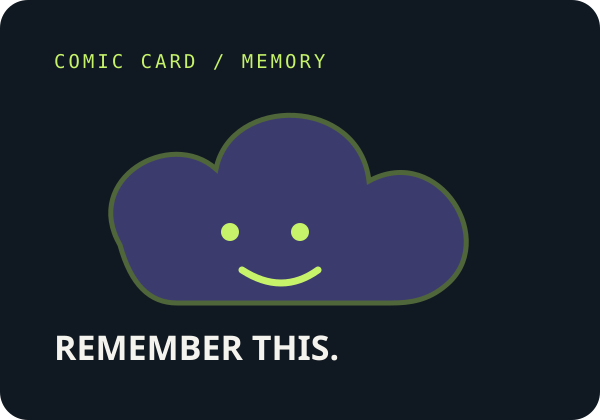
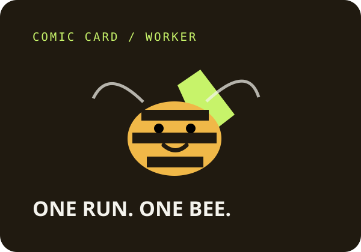
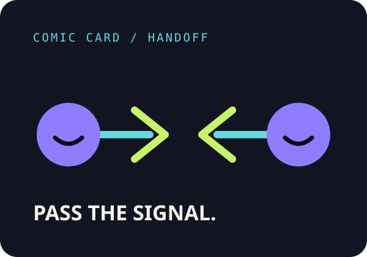
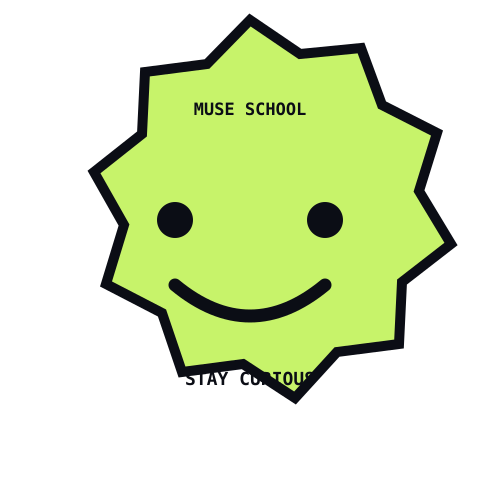

# FED's MUSE AI EDU

A dependency-free, dark-mode learning hub that turns Muse’s operating vocabulary into an animated, browsable field guide.

<p align="center">
  
</p>

<p align="center">
  <a href="./index.html"><strong>Open the school</strong></a> ·
  <a href="./lessons.html">Browse lessons</a> ·
  <a href="./assets.html">View the promo lab</a>
</p>

> **Status:** static HTML/CSS/JavaScript · no package manager · no build step · GitHub Pages and Cloudflare Pages/Workers friendly

## Why this exists

Muse has a lot of moving parts: schedules, jobs, workers, lanes, runs, handoffs, memory, reboots, verification, and posting rules. Those concepts are easy to blur together when they live only in conversation notes.

MUSE AI EDU makes the vocabulary easier to explore. It gives each concept a short lesson page, keeps the original Markdown source in the repository, and wraps the material in a visual system that feels more like a field guide than a documentation dump.

The project is intentionally plain static web technology. There is no framework to install, no database to configure, and no server-side runtime to keep alive. Copy the folder, serve it, and the school is running.

## See it work

There is no live deployment URL committed in this repository, so the quickest real demo is local:

```bash
python3 -m http.server 8080
```

Then open <http://localhost:8080> and select **Enter the school**. The homepage includes the animated signal-field background, looping ticker, orbit map, curriculum navigation, search, filters, and local progress tracking.

The visual personality is also available as a real animated asset:



### Real application screenshots

These screenshots were captured from the running static application with Chromium, not mocked up separately.

| Homepage and signal field | Curriculum browser |
| --- | --- |
|  |  |

| Promo lab and visual asset gallery |
| --- |
|  |

## Quick start

### Run locally

```bash
# from the repository root
python3 -m http.server 8080
```

Open <http://localhost:8080/index.html>.

There is no install command and no build command. A static server is recommended because lesson content is loaded from local Markdown files by the browser.

### Try the main workflow

1. Open `index.html`.
2. Select **Enter the school** or go directly to `lessons.html`.
3. Open a lesson card such as `lesson-01-cron.html`.
4. Use the top navigation to explore the docs, Promo Lab, Community, Support, and gated private-community page.
5. On the homepage, the curriculum reader supports search, lesson/reference filters, and browser-local completion progress.

## What is included

- **Animated learning interface** — dark signal field, orbit map, pulse effects, infinite ticker, responsive layout, and reduced-motion support.
- **14 lesson pages** — Cron, Job, Worker, Lane, Run, Handoff, Subagent, Memory, Skills + Connectors, The Browser, The VM Machine, Reboots + Lane Deaths, Verification, and Posting Rules.
- **3 reference pages** — Glossary, How a Cron Runs, and VM Overview.
- **Promo Lab** — logos, banners, comic cards, sticker art, and the animated GIF in `assets/`.
- **Community page** — centered Discord widget plus server buttons; the 18+ NSFW route uses an age confirmation and requests access by email instead of exposing an invite URL.
- **Support page** — age-gated subscription/donation area with provider checkout options and a GitHub Sponsor card.
- **Private Communities page** — age and country eligibility checks before revealing the restricted Matrix link.
- **Portable deployment files** — `404.html`, `_headers`, `site.webmanifest`, `manus-routes.json`, and `DEPLOYMENT.md`.

## Visual asset kit

All of these are real files in the repository and are used by the Promo Lab or the homepage.

### Logos and identity

<p align="center">
  
  
</p>

### Promotional banners

<p align="center">
  
  
</p>

<p align="center">
  
</p>

### Comic cards and sticker art

<p align="center">
  
  
  
</p>

<p align="center">
  
</p>

## Repository map

```text
.
├── index.html                 # homepage and interactive curriculum reader
├── lessons.html               # HTML lesson index
├── lesson-*.html              # 14 standalone lesson pages
├── docs.html                  # HTML reference index
├── doc-*.html                 # 3 standalone reference pages
├── about.html                 # project/about page
├── assets.html                # visual asset gallery
├── community.html             # Discord widget and server lanes
├── support.html               # age-gated subscription/donation page
├── private-communities.html   # age + country gate for restricted Matrix access
├── sponsor-gitfed.html        # standalone GitHub Sponsor card page
├── 404.html                   # static-hosting fallback page
├── app.js                     # homepage curriculum, search, progress, and canvas logic
├── site.js                    # shared pulse, clock, and particle effects
├── styles.css                 # complete responsive visual system
├── assets/                    # logos, banners, comic cards, sticker, and GIF
├── screenshots/               # real Chromium captures used above
├── docs/                      # source reference Markdown
├── lessons/                   # source lesson Markdown
├── _headers                   # Cloudflare Pages headers
├── site.webmanifest           # installable-site metadata
├── manus-routes.json          # static page route manifest
└── DEPLOYMENT.md              # GitHub Pages and Cloudflare deployment notes
```

## Deployment

### GitHub Pages

1. Push the repository to GitHub.
2. Open **Settings → Pages**.
3. Choose **Deploy from a branch**.
4. Select the branch and repository root.

All internal paths are relative, so the project also works under a repository subpath such as `https://username.github.io/repository-name/`.

### Cloudflare Pages

1. Connect the GitHub repository to Cloudflare Pages.
2. Choose the **None** framework preset.
3. Leave the build command empty.
4. Use the repository root as the output directory.

Cloudflare Pages will use `_headers` and `404.html` automatically. For a Workers Static Assets deployment, point the assets directory at the repository root; no server runtime is required.

More detail is available in [`DEPLOYMENT.md`](DEPLOYMENT.md).

## Content source

The interface is built from the supplied MUSE School notes. The editable source remains available in:

- [`lessons/`](lessons/) — the 14 lesson Markdown files
- [`docs/`](docs/) — the 3 reference Markdown files
- [`muse-school-file-tree.md`](muse-school-file-tree.md) — the source tree and future-topic notes

The HTML pages are intentionally standalone so they remain useful even when JavaScript is unavailable or a visitor wants to link directly to a lesson.

## Validation

The package has been checked for:

- JavaScript syntax with `node --check`
- Real local screenshots from Chromium
- Resolvable relative HTML and asset references
- Static route manifest coverage
- ZIP integrity with `unzip -t`

## License

No license file is currently included in the repository. Add a license before publishing the project for reuse if you want to define permissions for contributors and downstream users.
